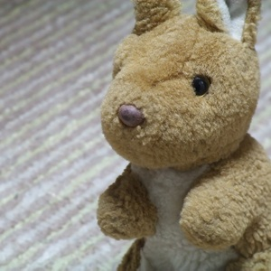

<!-- _class: lead -->

# Javaで絵文字を正しく扱おう🥲
## LT バージョン
<br>

 @YujiSoftware

---

# このコードを実行した結果は？

- Java 21 で **isEmoji メソッド**が追加された
    - 実際に Java 21 で動かすとなにが返ってくる？
```java
jshell> Character.isEmoji('🤧');
```

---

# このコードを実行した結果は？

- Java 21 で **isEmoji メソッド**が追加された
    - 実際に Java 21 で動かすとなにが返ってくる？
```java
jshell> Character.isEmoji('🤧');

$1 ==> false
```

---

# AI に聞きました（擬人化）

<div class="balloon balloon-right">
  <div>
    なんで false になるの？
  </div>
  
</div>

---

# AI に聞きました（擬人化）

<div class="balloon balloon-right">
  <div>
    なんで false になるの？
  </div>
  
</div>

<div class="balloon balloon-left">
  
  <div>
    それバグです！<br>Java 25 で修正しました！
  </div>
</div>

---

# 確認

- 改めて Java 25 で実行

```java
jshell> Character.isEmoji('🤧');
```

---

# 確認

- 改めて Java 25 で実行

```java
jshell> Character.isEmoji('🤧');

|  エラー:
|  文字リテラルに複数のUTF-16コード・ユニットが含まれています
|  Character.isEmoji('🤧');
|                    ^
```

---

# AI に聞きました（擬人化）

<div class="balloon balloon-right">
  <div>
    バグってるのですが…
  </div>
  
</div>

---

# AI に聞きました（擬人化）

<div class="balloon balloon-right">
  <div>
    バグってるのですが…
  </div>
  
</div>

<div class="balloon balloon-left">
  
  <div>
    そのとおり
  </div>
</div>

---

# AI に聞きました（擬人化）

<div class="balloon balloon-right">
  <div>
    バグってるのですが…
  </div>
  
</div>

<div class="balloon balloon-left">
  
  <div>
    そのとおり<br>
    <span class="bold">あなたのコードがバグっています！</span>
  </div>
</div>

---

# 解説

- **エラーになるのが正解 ⭕**
  - 文字リテラルに、サロゲートペアを入れてはいけない
- Java 24 までのコンパイラの処理が間違い
  - 上位サロゲートのみに切り捨てていた

```java
Character.isEmoji('🤧');
                   ↓
Character.isEmoji(\uD83E\uDD27);
                   ↓
Character.isEmoji(\uD83E); ←不正な文字 = 絵文字じゃない
```

---

# 正しいコード

- 文字列から**コードポイント**を取り出しましょう
```java
jshell> Character.isEmoji("🤧".codePointAt(0));

$1 ==> true
```

---

# このコードを実行した結果は？

- Java 21 で **isEmoji メソッド**が追加された
    - '0' を渡すとなにが返ってくる？
```java
jshell> Character.isEmoji('0');
```

---

# このコードを実行した結果は？

- Java 21 で **isEmoji メソッド**が追加された
    - '0' を渡すとなにが返ってくる？
```java
jshell> Character.isEmoji('0');

$1 ==> true
```

---

# AI に聞きました（擬人化）

<div class="balloon balloon-right">
  <div>
    なんで true になるの？
  </div>
  
</div>

---

# AI に聞きました（擬人化）

<div class="balloon balloon-right">
  <div>
    なんで true になるの？
  </div>
  
</div>

<div class="balloon balloon-left">
  
  <div>
    Unicode が絵文字だって言ってる！<br>（しらんがな）
  </div>
</div>

---

# Unicode の定義を確認

```
0023        ; Emoji  # E0.0   [1] (#️)     hash sign
002A        ; Emoji  # E0.0   [1] (*️)     asterisk
0030..0039  ; Emoji  # E0.0  [10] (0️..9️)  digit zero..digit nine
00A9        ; Emoji  # E0.6   [1] (©️)     copyright
00AE        ; Emoji  # E0.6   [1] (®️)     registered
```

- 数字は絵文字、だと？？？

---

# なぜ？

- **絵文字シーケンス**により、絵文字となるから
  - ↑ 複数のコードポイントを組み合わせて、1つの絵文字とする仕組み

---

# 具体例

- 0️⃣ （キーキャップ 0）という絵文字
  - **U+0030**：数字の 0
  - U+FE0F：異体字セレクター16（絵文字表示の指定）
  - U+20E3：キーキャップを表す合成文字（□） 

- 1つの絵文字に3つのコードポイント

---

# 絵文字シーケンス

- 新しい絵文字はだいたいこれ
  - ❤️‍🩹: U+2764, U+FE0F, U+200D, U+1FA79
  - 🫱🏻‍🫲🏼: U+1FAF1, U+1F3FB, U+200D, U+1FAF2, U+1F3FC
  - 🧎🏻‍♀️‍➡️: U+1F9CE, U+1F3FB, U+200D, U+2640, U+FE0F, U+200D, U+27A1, U+FE0F 
  - 🧑🏻‍❤️‍💋‍🧑🏼：U+1F9D1, U+1F3FB, U+200D, U+2764, U+FE0F, U+200D, U+1F48B, U+200D, U+1F9D1, U+1F3FC
- どう扱えばいいの！？？？

---

# 詳しく知りたい方は

- 本日のセッションで！
  - ROOM F にて 10:25〜

---

# 詳しく知りたい方は

- 本日のセッションで！
  - ROOM F にて 10:25〜

<div class="balloon balloon-left">
  
  <div>
    もう終わってるよ！
  </div>
</div>

---

# まとめ


---

# まとめ

* コンパイラですら間違える
  - 私達が正しく扱えるわけない

* エディタですら間違える
  - この資料を作る際にバグを踏みました

* <span class="yake">絵文字はめんどくさい！</span>

---

<!-- _class: lead -->

# Javaで絵文字を正しく扱おう🥲
## LTバージョン
<br>

 @YujiSoftware
